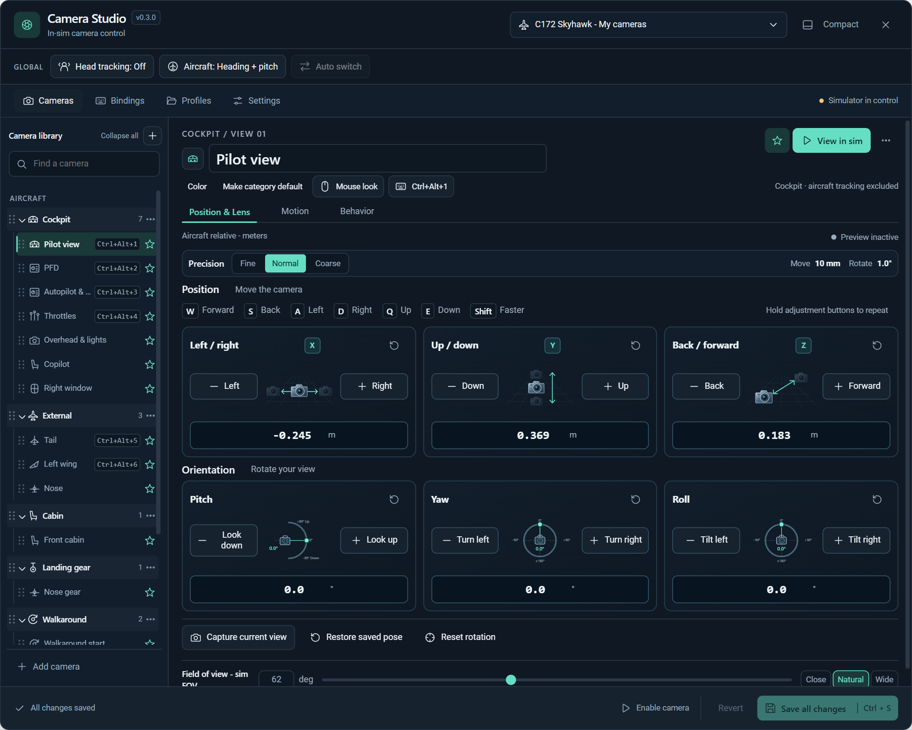
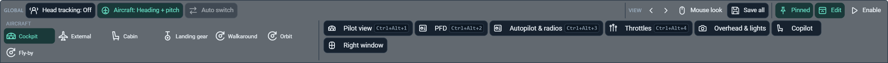

# FS Camera Studio

A camera manager for **Microsoft Flight Simulator 2024** that lives entirely inside the simulator: aircraft
profiles, organised views, precise editing, smooth transitions and shortcuts — opened from the sim's toolbar, with a
mini control panel at the bottom of the screen.

**Status: in-sim testing, with a new build awaiting live verification.** The module and panels have run in MSFS;
version 0.3.0 includes the latest controller hat-release correction and is built with SDK 1.7.3.
Automated checks and installed-file verification are separate from live controller and scenery acceptance.
Camera axes, template poses and hosting behaviour still require live qualification — see
[`doc/qualification.md`](doc/qualification.md).

[Download 0.3.0](https://github.com/Devinci297/FS_Camera_Studio/releases/tag/v0.3.0)
for the Windows installer, illustrated manual, example profile and checksums.





These screenshots use the packaged UI with browser demo data; they are not live simulator captures.

## How it works

```text
MSFS toolbar ── "Camera Studio" panel (full editor)      ┐  HTML/CSS/JS (ui/)
             └─ "Camera Studio Mini" panel (bottom dock) ┘
                         │  CommBus (FSCS_UI_TO_HOST / FSCS_HOST_TO_UI)
                         ▼
FSCameraStudio.wasm — standalone module loaded by MSFS from the package
   working drafts · profiles (\work storage) · input bindings · coordinator · motion engine
                         │
                  WASM Camera API (fsCamera*) — the only camera writer
```

There is no desktop app, background service or external process. Both panels are mirrors of one authoritative
state held in the module, so the editor and the mini panel always agree.

* **Safety first:** the module starts in *Observing* and never moves the view on its own. Release Camera is always
  available (both panels and a binding). If anything goes wrong — another add-on takes the camera, the sim takes
  over, a release can't be confirmed — it stops writing and hands control back.
* **Profiles** are matched to the loaded aircraft by its package (liveries keep the same profile). Saves are one
  transaction (profile + settings + bindings), written to one of two checksummed slots and verified by readback, so
  an interrupted save can never damage the last good one. Five backups per profile.
  Each aircraft also gets a readable, importable JSON file alongside these recovery slots; see
  [`doc/profile-storage.md`](doc/profile-storage.md). The C172 automatically receives a 20-view starter profile
  (12 cockpit, 8 exterior) the first time this template is used. It does not move the camera on load.
* **Bindings** provide independent Primary and Secondary slots for keyboard and controller inputs. Choose a
  controller from the visible list, select **Listen for button or hat**, press and release a button or return the hat
  to center, then **Assign**. Inputs work with the editor closed. See [binding guidance](doc/dual-bindings.md).
* **Library layout:** category headers contain indented, single-line camera rows, with inline shortcuts and a
  distinct active-view indicator. The main editor shows every camera with its icon and name; the wide bottom mini
  panel shows starred cameras. Its Icons/Labels/Both preference applies only to categories.
* **Reuse profiles:** **Copy for current aircraft** creates a separately matched copy for any loaded aircraft,
  retaining the source. Positions may need adjustment for the destination cockpit; see
  [copying profiles](doc/copy-profile-for-aircraft.md).
* **Camera directions:** configured automatically; users do not need to run an axis calibration.
* **Tracking:** head tracking defaults off. Aircraft tracking defaults to heading and pitch for exterior and airport
  views. Both preferences are global and survive camera/profile changes; cockpit views never track the aircraft.
* **Airport cameras:** open **Camera library + → Create airport cameras**, choose a nearby airport or enter ICAOs,
  preview generated views and save the selected ones. Runway, gate/apron, tower and offset taxiway-intersection
  views use available scenery facility data. Optional airport XML supplies actual taxi-sign positions.
  Airport views are stored globally, independently of aircraft profiles. One nearby saved airport loads at a time. See
  [airport defaults and overrides](doc/airport-camera-settings.md) for global tracking, category heights, auto zoom
  and distant-target horizon protection. Each airport camera can override these defaults independently.

## Build

The tester release and illustrated manual are available from
[GitHub Releases](https://github.com/Devinci297/FS_Camera_Studio/releases).
The app bar displays the version; click it for update detection and the installer download.
Close MSFS before installing an update. Airport cameras that have been generated **and saved**
load automatically within the configured radius (25 NM by default); Auto switch is a separate viewpoint control.

### Reproduce version 0.3.0

The reviewed simulator host is frozen in `package/validated-host`, with hashes in
`package/validated-host.json`. This preserves the native pointer routing used by the installed build.

```powershell
python tools/diagnostics/stage-v0.3.py --freeze
tools\build.ps1 -ModuleOnly -OutputDirectory build/wasm/release-0.3.0
python tools/diagnostics/stage-v0.3.py
python tools/build-manual.py
python tools/build-installer.py --version 0.3.0 --package build/release/0.3.0/fs-camera-studio --receipt build/release/0.3.0/staged.json
```

See [release notes](doc/releases/0.3.0.md), [A320 starter guidance](doc/A320-starter-profile.md)
and the bundled illustrated manual. [Release evidence and live checks](doc/test-evidence/2026-10-11-v0.3.0.md)
separate automated verification from simulator acceptance. Earlier tester recipes remain available in their Git tags.

Install ReportLab for manual generation and obtain Inno Setup with `tools/get-installer-compiler.ps1`.
`package/validated-host` freezes the reviewed toolbar host, including compiled panel definitions;
its receipt is `package/validated-host.json`. The release stage uses this reviewed host, current version metadata and the rebuilt module.
This intentionally preserves the known-loading host while broader `ui/` host changes still need flight-loading
qualification. Do not replace the release host wholesale with the development panel. The generated receipt,
installer and PDF are under `build/release`, `dist` and `output/pdf` respectively. Nothing is installed by these commands.

For a shareable Windows tester setup, see [`installer/README.md`](installer/README.md).
The installer packages an explicitly verified build, detects the MSFS Community folder, supports upgrades and
uninstall, and preserves saved camera profiles. Testers do not need the SDK or developer tools.

Requirements: Windows 11 x64, the MSFS 2024 SDK (`MSFS2024_SDK` set; 1.7.3 is the baseline), PowerShell. For the
native tests: Visual Studio 2022 Build Tools and CMake 3.25+.

```powershell
tools\build.ps1                 # WASM module + staged MSFS project in build\project
tools\package.ps1 -Compile      # compile the toolbar panels with fspackagetool -> build\package
tools\install.ps1               # link the package into your Community folder (close MSFS first)
```

Native tests (pure engine, profiles, protocol, coordinator and module logic against fake adapters):

```powershell
cmake --preset tests
cmake --build --preset tests
ctest --preset tests
```

UI tests and browser preview: `node ui/tests/math.test.mjs`, `node ui/tests/bridge.test.mjs`,
`node ui/tests/panel.test.mjs`, and open
`ui/index.html` in a browser (demo mode with an in-memory module).

## Repository layout

| Path | Contents |
| --- | --- |
| `src/CameraCore` | Pure math: frames, quaternions, transitions, manual movement |
| `src/Profiles` | Profile schema v2, validation, bindings/settings, the two-slot repository, profile codes |
| `src/Protocol` | Panel ⇄ module envelopes and CommBus chunking |
| `src/WasmModule` | Coordinator, input router and module app (pure); `wasm/` holds the SDK adapters and entry points |
| `ui/` | The in-sim panels (one codebase, `main` and `mini` surfaces) |
| `package/` | MSFS project, package definition, toolbar panel definitions and icons |
| `tests/` | Native test suite with fake camera, services and storage |
| `doc/` | [`protocol.md`](doc/protocol.md) (the contract) and [`qualification.md`](doc/qualification.md) (in-sim gates) |
| `tools/` | Build, package and install scripts |
