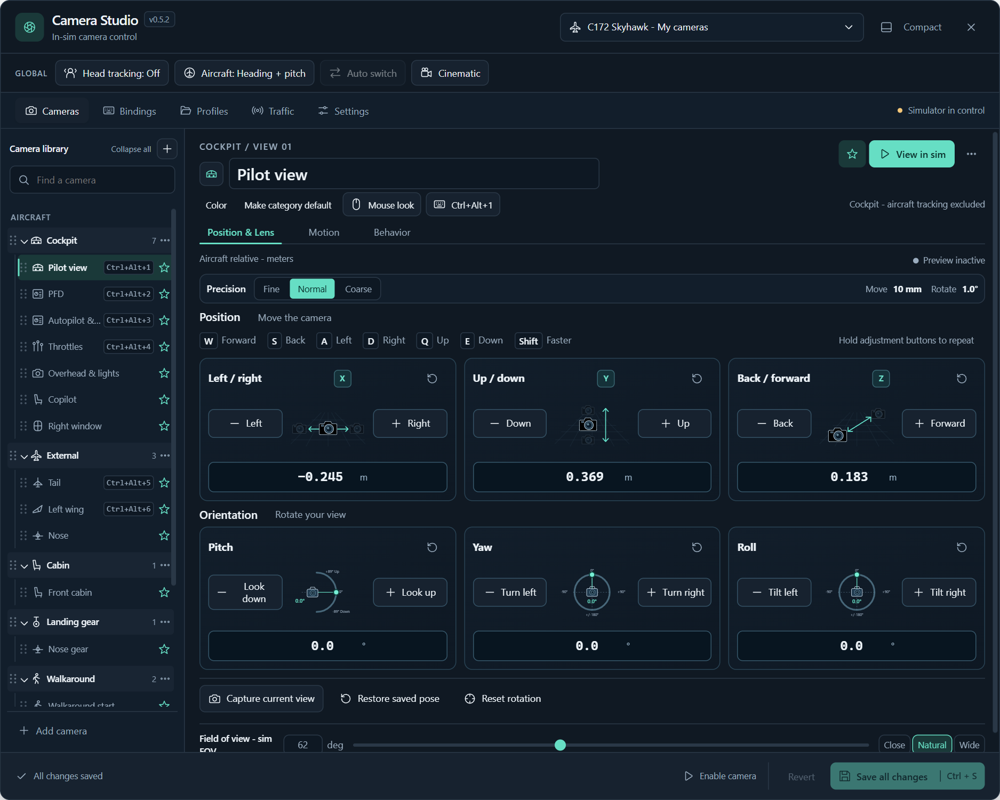
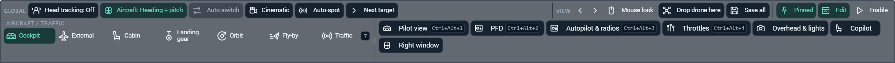

# FS Camera Studio

A camera manager for **Microsoft Flight Simulator 2024** and **X-Plane 12** that lives entirely inside the simulator:
aircraft profiles, organised views, precise editing, smooth transitions and shortcuts — opened from the sim's
toolbar or menu, with a mini control panel at the bottom of the screen. The X-Plane version is called
**XP Camera Studio**; it runs the same module logic and the same editor and mini panel (see
[X-Plane 12](#x-plane-12-xp-camera-studio)).

**Version 0.5.3:** one Windows installer for Microsoft Flight Simulator 2024, X-Plane 12, or both.
Update now downloads and installs updates silently for both simulators, with a restart choice when needed.
Install this setup once to enable the complete workflow; future updates are offered in the editor and mini panel.
Automated validation is recorded below; live acceptance of these patch changes is pending.
The MSFS build uses SDK 1.8.1; XP Camera Studio requires X-Plane 12.4.4 or newer on Windows x64.
Both simulators share one version number and one update check.

[Download 0.5.3](https://github.com/Devinci297/FS_Camera_Studio/releases/tag/v0.5.3)
for the Windows installer, illustrated manual, example profile and checksums.

See the [release notes](doc/releases/0.5.3.md) and
[validation record](doc/test-evidence/2026-11-07-v0.5.3.md) for automated checks, live acceptance and known limits.
Aircraft-specific camera poses and controller setups can still need adjustment; see
[`doc/qualification.md`](doc/qualification.md).





These screenshots use the packaged UI with browser demo data; they are not live simulator captures.

## How it works

```text
MSFS toolbar ── "Camera Studio" panel (full editor)      ┐  HTML/CSS/JS (ui/)
             └─ "Camera Studio Mini" panel (bottom dock) ┘
                         │  CommBus (FSCS_UI_TO_HOST / FSCS_HOST_TO_UI)
                         ▼
FSCameraStudio.wasm — standalone module loaded by MSFS from the package
   working drafts · profiles (\work storage) · input bindings · coordinator · motion engine
                         │
                  WASM Camera API (fsCamera*) — the only camera writer
```

Normal camera operation needs no desktop app or background service. The bundled Windows updater opens only
when requested and waits for the simulators to close before installation. X-Plane also includes a small helper
that applies queued native keyboard assignments after the simulator exits. Both panels are mirrors of one authoritative
state held in the module, so the editor and the mini panel always agree.

In X-Plane 12 the same module and UI run inside a native plugin:

```text
Plugins menu / xpcs/ commands ── editor and mini panel in X-Plane browser windows (the same ui/)
                         │  xplane.fscs(frame) / FSCXPlaneReceive(frame), the same protocol
                         ▼
XPCameraStudio.xpl — X-Plane plugin, run from a flight loop
   the same module logic · profiles as files · apt.dat airports · TCAS traffic
                         │
        pilots_head datarefs (cockpit views) · XPLMControlCamera (exterior, airport, spotting)
```

* **Safety first:** the module starts in *Observing* and never moves the view on its own. Release Camera is always
  available (both panels and a binding). If anything goes wrong — another add-on takes the camera, the sim takes
  over, a release can't be confirmed — it stops writing and hands control back.
* **Profiles** support up to **2,000 cameras**; airport generation remains capped at 500 to leave room for
  personal views. Profiles are matched to the loaded aircraft by its package (liveries keep the same profile). Saves are one
  transaction (profile + settings + bindings), written to one of two checksummed slots and verified by readback, so
  an interrupted save can never damage the last good one. Five backups per profile.
  Each aircraft also gets a readable, importable JSON file alongside these recovery slots; see
  [`doc/profile-storage.md`](doc/profile-storage.md). The C172 automatically receives a 20-view starter profile
  (12 cockpit, 8 exterior) the first time this template is used. It does not move the camera on load.
* **Bindings** provide independent Primary and Secondary slots for keyboard and controller inputs. Choose a
  controller from the visible list, select **Listen for button or hat**, press and release a button or return the hat
  to center, then **Assign**. Inputs work with the editor closed. See [binding guidance](doc/dual-bindings.md).
* **Smart views:** mark instrument close-ups as **Glance view** (instrument views are by default). Hold
  **Ctrl + Alt + G** to glance at the one nearest to where you are looking and release to return to the exact view and
  look; **Ctrl + Alt + I** steps through them and **Ctrl + Alt + U** returns. See [smart views](doc/dual-bindings.md#smart-views-glance).
* **Cinematic mode:** **Cinematic** next to Auto switch, or **Ctrl + Alt + K**, plays an automatic playlist of views
  chosen for the flight phase, with smooth moves, cuts and an optional slow Commercial drift. Manual movement pauses
  it; Release, Panic or selecting a view stops it. See [Cinematic mode](doc/dual-bindings.md#cinematic-mode).
* **Spotting:** a live list of AI and multiplayer traffic (VATSIM / IVAO aircraft included) with tower, runway,
  chase, fly-by and track views of any aircraft, **Ctrl + Alt + T / Y** for the next / previous aircraft, **Ctrl + Alt
  + O** to return and **Ctrl + Alt + J** for auto-spot, which follows landings and departures at the airport. See
  [Spotting](doc/dual-bindings.md#spotting).
* **Library layout:** category headers contain indented, single-line camera rows, with inline shortcuts and a
  distinct active-view indicator. The main editor shows every camera with its icon and name; the wide bottom mini
  panel shows starred cameras. Its Icons/Labels/Both preference applies only to categories.
* **Reuse profiles:** **Copy for current aircraft** creates a separately matched copy for any loaded aircraft,
  retaining the source. Positions may need adjustment for the destination cockpit; see
  [copying profiles](doc/copy-profile-for-aircraft.md).
* **Second monitor:** **Pop out** in the editor header moves the editor into its own desktop window, which you can
  drag to another screen; **Dock** puts it back. This is the simulator's own pop-out (Right Alt + click on the editor
  does the same). A popped-out editor is always opaque. It is not offered in VR, and the mini panel stays docked.
* **Camera directions:** configured automatically; users do not need to run an axis calibration.
* **Tracking:** head tracking defaults off. Aircraft tracking defaults to heading and pitch for exterior and airport
  views. Both preferences are global and survive camera/profile changes; cockpit views never track the aircraft.
* **Airport cameras:** open **Camera library + → Create airport cameras**, choose a nearby airport or enter ICAOs,
  preview generated views and save the selected ones. Runway, gate/apron, tower and offset taxiway-intersection
  views use available scenery facility data. Optional airport XML supplies actual taxi-sign positions.
  Airport views are stored globally, independently of aircraft profiles. One nearby saved airport loads at a time.
  Near an airport without saved views, a **temporary** set (tower or virtual tower, runway ends, fence-line and
  1 NM approach spotting views, a few gates) loads automatically; choose **Save** in the library to keep it, or turn
  it off in Settings > Airport defaults. In the browser demo, open `ui/index.html?demoAirport=1`. See
  [airport defaults and overrides](doc/airport-camera-settings.md) for global tracking, category heights, auto zoom
  and distant-target horizon protection. Each airport camera can override these defaults independently.

## X-Plane 12 (XP Camera Studio)

Everything above works the same in X-Plane, with these differences:

* **Opening it:** Plugins > XP Camera Studio > Editor / Mini panel, or the commands `xpcs/toggle_editor` and
  `xpcs/toggle_mini`. The editor can be popped out to its own window; the mini panel shows on hover at the bottom.
* **Bindings are X-Plane commands.** Every action is an `xpcs/` command (`xpcs/view_1` to `xpcs/view_30`,
  `xpcs/peek_1` to `xpcs/peek_30`, `xpcs/next_camera`, `xpcs/spot_next` and so on). The Bindings tab lists each one
  with **Copy**. Camera-view keys can also be assigned directly: choose **Assign key binding**, select
  your X-Plane controls profile, review conflicts, then **Assign after exit**. The bundled helper backs up the
  native preferences and replaces conflicting assignments after X-Plane closes; keys take effect next launch.
  Other keys and controller buttons use X-Plane's Keyboard and Joystick settings. See
  [native camera-key assignment](doc/xplane-camera-bindings.md). Read-only datarefs
  (`xpcs/camera_active`, `xpcs/active_view`, `xpcs/active_camera`, `xpcs/fov_deg` and more) are published for
  cockpit builders and scripts.
* **Cameras:** cockpit views move the pilot's head, so the 3D cockpit stays clickable; exterior, orbit, fly-by,
  airport and spotting views are drawn by the plugin. Picking another X-Plane view hands the camera back.
* **Airports** come from X-Plane's own scenery: every enabled pack in `scenery_packs.ini` plus Global Airports, with
  X-Plane's priority (your custom scenery wins). Runways, the tower, gates and parking, the taxi network and taxi
  signs come from `apt.dat`.
* **Spotting** follows X-Plane's AI traffic and anything multiplayer or traffic plugins publish to X-Plane's TCAS
  targets.
* **X-Camera import:** Profiles > Import also lists X-Camera's camera files for the loaded aircraft and converts them
  into a new profile.
* **Profiles** are saved in `X-Plane 12/Output/preferences/XPCameraStudio`.

Requirements: X-Plane 12.4.4 or newer on Windows 11 x64. Details, the full command and dataref lists and the build
are in [`src/XPlanePlugin/README.md`](src/XPlanePlugin/README.md).

## Build

The tester release and illustrated manual are available from
[GitHub Releases](https://github.com/Devinci297/FS_Camera_Studio/releases).
The app bar displays the version. Automatic checks notify you every six hours while a panel is open.
**Update now** downloads, verifies and silently installs the official update. If a simulator is running, choose
**Restart and install** after saving your flight, or **When I close the sims** to defer. The updater preserves
your selected simulators, installation folders and profiles. Recovery downloads are under **Update troubleshooting**.
See [updates](doc/automatic-updates.md).
Close MSFS before installing an update. Saved airport cameras load automatically within the configured radius
(25 NM by default); other airports get a temporary set until you save it. Auto switch is a separate viewpoint control.

### Reproduce version 0.5.3

The reviewed simulator host is frozen in `package/validated-host`, with hashes in
`package/validated-host.json`. It is refreshed from the compiled package of the release commit, the same
`tools\package.ps1 -Compile` build that is flown during testing. Close MSFS before the compile step. The X-Plane
plugin is built at the same version and goes into the same setup.

```powershell
python tools/diagnostics/stage-v0.5.3.py --freeze
cmake --preset tests; cmake --build --preset tests; ctest --preset tests
tools\build.ps1 -ModuleOnly -OutputDirectory build/wasm/release-0.5.3
tools\package.ps1 -Compile -Wasm build/wasm/release-0.5.3/FSCameraStudio.wasm -OutputDirectory build/release-0.5.3-compile
python tools/diagnostics/stage-v0.5.3.py --host build/release-0.5.3-compile/Packages/fs-camera-studio
python tools/diagnostics/stage-v0.5.3.py
cmake -S . -B build-xp -G "Visual Studio 17 2022" -A x64 -DFSCS_BUILD_XPLANE=ON
cmake --build build-xp --config Release --target xpcs_plugin
node tools/capture-manual.cjs
python tools/build-manual.py
python tools/build-installer.py --version 0.5.3 --package build/release/0.5.3/fs-camera-studio --receipt build/release/0.5.3/staged.json --xplane build-xp/XPCameraStudio
python tools/build-installer.py --test-harness --version 0.5.3 --package build/release/0.5.3/fs-camera-studio --receipt build/release/0.5.3/staged.json --xplane build-xp/XPCameraStudio
tools\test-updater.ps1 -LiveDownload
python tools/test-installer.py --test-harness --version 0.5.3
```

See [release notes](doc/releases/0.5.3.md), [A320 starter guidance](doc/A320-starter-profile.md)
and the bundled illustrated manual. [0.5.3 release evidence and live checks](doc/test-evidence/2026-11-07-v0.5.3.md)
separate automated verification from simulator acceptance. Earlier tester recipes remain available in their Git tags.

Install ReportLab for manual generation and obtain Inno Setup with `tools/get-installer-compiler.ps1`.
`package/validated-host` freezes the reviewed toolbar host, including compiled panel definitions;
its receipt is `package/validated-host.json`. The release stage uses this reviewed host, current version metadata and the rebuilt module.
Refresh the host from the compiled release package and commit it with its receipt. Record automated checks
and live simulator acceptance separately; do not carry acceptance from an earlier build forward. The generated receipt,
installer and PDF are under `build/release`, `dist` and `output/pdf` respectively. Nothing is installed by these commands.

For a shareable Windows tester setup, see [`installer/README.md`](installer/README.md).
The installer packages an explicitly verified build, detects the MSFS Community folder, supports upgrades and
uninstall, and preserves saved camera profiles. Testers do not need the SDK or developer tools.

Requirements: Windows 11 x64, the MSFS 2024 SDK (`MSFS2024_SDK` set; 1.8.1 is the baseline), PowerShell. For the
native tests: Visual Studio 2022 Build Tools and CMake 3.25+.

```powershell
tools\build.ps1                 # WASM module + staged MSFS project in build\project
tools\package.ps1 -Compile      # compile the toolbar panels with fspackagetool -> build\package
tools\install.ps1               # link the package into your Community folder (close MSFS first)
```

Native tests (pure engine, profiles, protocol, coordinator and module logic against fake adapters):

```powershell
cmake --preset tests
cmake --build --preset tests
ctest --preset tests
```

UI tests and browser preview: `node ui/tests/math.test.mjs`, `node ui/tests/bridge.test.mjs`,
`node ui/tests/panel.test.mjs`, and open
`ui/index.html` in a browser (demo mode with an in-memory module).

X-Plane plugin (Visual Studio 2022 x64; the X-Plane SDK is vendored in `third_party/XPSDK`):

```powershell
cmake -S . -B build-xp -G "Visual Studio 17 2022" -A x64 -DFSCS_BUILD_XPLANE=ON
cmake --build build-xp --config Release --target xpcs_plugin   # -> build-xp\XPCameraStudio
```

Copy `build-xp\XPCameraStudio` to `X-Plane 12\Resources\plugins\`. The plugin's own test runs it against a fake
X-Plane (`xpcs_fake_xplane`, also on Linux); `node ui/tests/xplane-bridge.test.mjs` and
`node ui/tests/xplane-bindings.test.cjs` cover the X-Plane side of the UI.

## Repository layout

| Path | Contents |
| --- | --- |
| `src/CameraCore` | Pure math: frames, quaternions, transitions, manual movement |
| `src/Profiles` | Profile schema v4, validation, bindings/settings, the two-slot repository, profile codes |
| `src/Protocol` | Panel ⇄ module envelopes and CommBus chunking |
| `src/WasmModule` | Coordinator, input router and module app (pure); `wasm/` holds the SDK adapters and entry points |
| `src/XPlanePlugin` | XP Camera Studio: the X-Plane 12 plugin (camera, panels, storage, apt.dat airports, TCAS traffic) and its fake-X-Plane test |
| `ui/` | The in-sim panels (one codebase, `main` and `mini` surfaces) |
| `package/` | MSFS project, package definition, toolbar panel definitions and icons |
| `tests/` | Native test suite with fake camera, services and storage |
| `doc/` | [`protocol.md`](doc/protocol.md) (the contract) and [`qualification.md`](doc/qualification.md) (in-sim gates) |
| `tools/` | Build, package and install scripts |
